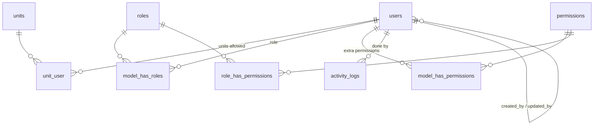
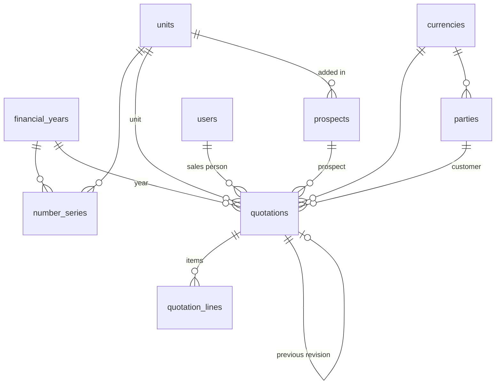

# Nursery database design (MySQL 8 or MariaDB 10.4+)

Part 1 lists the tables that exist now (admin and CRM modules). Part 2 is the plan for every other module in the workbook, so later modules slot in without reworking these tables. Planned tables are **not created yet**; each is built with its module.

## Conventions (decision A6)

| Rule | Example |
|---|---|
| Tables are plural snake_case, pivots are the two singular names in alphabetical order | `users`, `sales_orders`, `unit_user` |
| Every table has `id BIGINT UNSIGNED` primary key; pivots use a composite primary key | `unit_user (unit_id, user_id)` |
| Foreign keys are `<singular>_id` with a real `FOREIGN KEY` constraint and an index | `sales_orders.party_id → parties.id` |
| Money `DECIMAL(15,2)`, quantities `DECIMAL(15,3)`, rates `DECIMAL(15,4)`, tax % `DECIMAL(5,2)` | |
| Dates are `DATE`, moments are `TIMESTAMP`, shown as dd/mm/yyyy, India time | OTHER POINTS A18 |
| Fixed value lists are MySQL `ENUM` backed by a PHP enum | `users.status` |
| Every editable record has `created_by`, `updated_by`, `created_at`, `updated_at` (audit, OTHER POINTS A24) | |
| Records others point at are soft deleted (`deleted_at`) so history stays intact | `users` |
| Every transaction belongs to a unit and a financial year; its number is unique within them | `UNIQUE (unit_id, financial_year_id, so_no)` |
| Masters are not financial-year wise (OTHER POINTS A22) | `parties`, `items` |
| Every change writes one row to `activity_logs`, inside the same database transaction | |
| Charset `utf8mb4`, collation `utf8mb4_unicode_ci`, engine InnoDB | |

## Part 1. Tables built now

### users
| Column | Type | Null | Key / rule |
|---|---|---|---|
| id | bigint unsigned | no | PK |
| name | varchar(255) | no | INDEX (Users list sort), required, 2 to 100 characters |
| email | varchar(255) | no | UNIQUE, login email |
| mobile | varchar(10) | no | UNIQUE, 10 digits |
| email_verified_at | timestamp | yes | Laravel standard, unused |
| password | varchar(255) | no | bcrypt hash |
| status | enum('Active','Inactive') | no | INDEX, default Active |
| last_login_at | timestamp | yes | INDEX (Users list sort), set on sign-in |
| remember_token | varchar(100) | yes | "Keep me signed in" |
| created_by, updated_by | bigint unsigned | yes | FK → users.id, ON DELETE SET NULL |
| created_at, updated_at, deleted_at | timestamp | yes | soft delete |

### units (company plants, decision D10)
| Column | Type | Null | Key |
|---|---|---|---|
| id | bigint unsigned | no | PK |
| code | varchar(10) | no | UNIQUE |
| name | varchar(100) | no | |
| created_at, updated_at | timestamp | yes | |

### unit_user (Units allowed)
| Column | Type | Key |
|---|---|---|
| unit_id | bigint unsigned | PK part, FK → units.id ON DELETE CASCADE |
| user_id | bigint unsigned | PK part, INDEX, FK → users.id ON DELETE CASCADE |

### roles, permissions and their pivots (spatie/laravel-permission)
| Table | Columns | Keys |
|---|---|---|
| roles | id, name, guard_name, timestamps | UNIQUE (name, guard_name) |
| permissions | id, name (`page.action`), guard_name, timestamps | UNIQUE (name, guard_name) |
| role_has_permissions | permission_id, role_id | PK both, FKs ON DELETE CASCADE |
| model_has_roles | role_id, model_type (`user`), model_id | PK all three, INDEX (model_id, model_type), FK role_id |
| model_has_permissions | permission_id, model_type (`user`), model_id | PK all three, INDEX (model_id, model_type), FK permission_id |

59 permissions are seeded from `config/nursery.php`: one per page and action (View / Add / Edit / Delete).

### activity_logs
| Column | Type | Null | Key |
|---|---|---|---|
| id | bigint unsigned | no | PK |
| user_id | bigint unsigned | yes | FK → users.id ON DELETE SET NULL |
| user_name | varchar(100) | yes | name at the time, kept if the user is renamed |
| action | varchar(50) | no | INDEX, e.g. `user.created`, `role.permissions_updated` |
| subject_type, subject_id | varchar(255), bigint unsigned | yes | INDEX (subject_type, subject_id), polymorphic: `user`, `role`, later `sales_order` and others |
| subject_label | varchar(191) | yes | readable name at the time |
| description | varchar(500) | no | |
| changes | json | yes | before/after values, or added/removed permissions |
| ip_address | varchar(45) | yes | IPv4 or IPv6 |
| user_agent | varchar(500) | yes | |
| created_at | timestamp | no | INDEX, rows are never updated |

Also INDEX `activity_logs_action_id_index` (action, id) for the Action filter in id order, and INDEX `activity_logs_user_created_index` (user_id, created_at) for the Done by filter with a date range. The Activity log page pages with Previous / Next (`simplePaginate`), so it never counts the whole table; newest first by id.

Laravel's own tables are also created: `sessions`, `cache`, `cache_locks`, `jobs`, `job_batches`, `failed_jobs`, `password_reset_tokens`, `migrations`.

### CRM and the tables it needs (built with the CRM module)

#### financial_years (decision D20)
| Column | Type | Null | Key |
|---|---|---|---|
| id | bigint unsigned | no | PK |
| code | varchar(5) | no | UNIQUE, e.g. `26-27` |
| starts_on, ends_on | date | no | 1 April to 31 March |
| is_current | boolean | no | default false |
| created_at, updated_at | timestamp | yes | |

The seeder and the daily `nursery:financial-years` command create this year's and next year's rows ahead of 1 April and keep `is_current` on this year only. If a row is still missing it is created race-safe (`createOrFirst` on the unique code), and the year is looked up once per request.

#### number_series (decision D16)
| Column | Type | Null | Key |
|---|---|---|---|
| id | bigint unsigned | no | PK |
| document_type | varchar(30) | no | `enquiry`, `quotation`, later `sales_order` and others |
| prefix | varchar(10) | no | `ENQ`, `QT` |
| next_number | int unsigned | no | default 1 |
| unit_id | bigint unsigned | no | FK → units.id ON DELETE RESTRICT |
| financial_year_id | bigint unsigned | no | FK → financial_years.id ON DELETE RESTRICT |
| created_at, updated_at | timestamp | yes | |

UNIQUE (document_type, unit_id, financial_year_id). Taking a number locks the row first (`SELECT … FOR UPDATE`) and inserts it only when it is missing, inside the saving transaction, so two users saving at once never get the same number and never deadlock. Saves retry up to 3 times after a deadlock. An import reserves its whole block of numbers in one short locked step and inserts afterwards, so it never holds the lock while it inserts; a failed import can leave unused numbers in Enquiry and Quotation (decision C12). Tax invoices will keep the lock for the whole save, because GST needs an unbroken series. Format `PREFIX/26-27/0001`.

Checked on a throwaway MariaDB copy on 09/10/2026: 12 processes saving 25 quotations each in one unit and year gave 300 of 300 saves, numbers 0001 to 0300, no gaps, no duplicates.

#### currencies
| Column | Type | Null | Key |
|---|---|---|---|
| id | bigint unsigned | no | PK |
| country | varchar(100) | no | |
| code | varchar(3) | no | UNIQUE (`INR`, `USD`, `EUR` are seeded) |
| symbol | varchar(5) | no | |
| created_at, updated_at | timestamp | yes | |

#### parties (Party master; the screen is not built yet, decision C2)
| Column | Type | Null | Key |
|---|---|---|---|
| id | bigint unsigned | no | PK |
| name | varchar(150) | no | INDEX |
| gstin | varchar(15) | yes | UNIQUE when given |
| type | enum('Customer','Supplier','Both') | no | INDEX (type, status) |
| billing_address, shipping_address | text | yes | |
| payment_terms | varchar(100) | yes | |
| opening_balance | decimal(15,2) | no | default 0 |
| opening_balance_type | enum('DR','CR') | no | default DR |
| currency_id | bigint unsigned | yes | FK → currencies.id ON DELETE RESTRICT |
| status | enum('Active','Inactive') | no | default Active |
| created_by, updated_by | bigint unsigned | yes | FK → users.id ON DELETE SET NULL |
| created_at, updated_at, deleted_at | timestamp | yes | soft delete |

#### prospects (CRM › Prospect)
| Column | Type | Null | Key / rule |
|---|---|---|---|
| id | bigint unsigned | no | PK |
| name | varchar(150) | no | INDEX, required |
| market | enum('Domestic','Export') | no | INDEX, required |
| contact_person, position | varchar(100) | yes | |
| phone_1 | varchar(20) | no | INDEX (picker "starts with" search), required, Contact no 1 |
| phone_2 | varchar(20) | yes | Contact no 2 |
| email | varchar(191) | yes | |
| gstin | varchar(15) | yes | 15 character GSTIN format |
| industry_type | varchar(100) | yes | |
| address | text | yes | |
| unit_id | bigint unsigned | yes | FK → units.id ON DELETE SET NULL, unit it was added in (C6) |
| created_by, updated_by | bigint unsigned | yes | FK → users.id ON DELETE SET NULL |
| created_at | timestamp | yes | INDEX; INDEX `prospects_unit_created_index` (unit_id, created_at) for the Prospects report's Unit and date filter |
| updated_at, deleted_at | timestamp | yes | soft delete |

#### quotations (CRM › Quotation, one row per revision, decision D24)

The CRM changes of 13/10/2026 added columns to this table (enquiry, dates, terms, totals, status); see "CRM changes" at the end.
| Column | Type | Null | Key / rule |
|---|---|---|---|
| id | bigint unsigned | no | PK |
| unit_id | bigint unsigned | no | FK → units.id ON DELETE RESTRICT |
| financial_year_id | bigint unsigned | no | FK → financial_years.id ON DELETE RESTRICT |
| enquiry_no | varchar(30) | no | `ENQ/26-27/0001`, shared by all revisions |
| quotation_no | varchar(30) | no | `QT/26-27/0001`, shared by all revisions |
| revision_no | smallint unsigned | no | 0, 1, 2 … |
| previous_revision_id | bigint unsigned | yes | FK → quotations.id ON DELETE SET NULL |
| is_latest | boolean | no | the current revision; earlier ones are read-only |
| party_id | bigint unsigned | yes | FK → parties.id ON DELETE RESTRICT, customer |
| prospect_id | bigint unsigned | yes | FK → prospects.id ON DELETE RESTRICT; customer or prospect is required |
| source_of_enquiry, reference | varchar(100) | yes | |
| project_name | varchar(150) | yes | |
| sales_person_id | bigint unsigned | no | FK → users.id ON DELETE RESTRICT, a user with the Sales role (D22) |
| enquiry_receipt_date | date | no | INDEX (Enquiries report) |
| currency_id | bigint unsigned | no | FK → currencies.id ON DELETE RESTRICT, default INR |
| followup_status | enum('New','Contacted','Quotation sent','Negotiation','Won','Lost') | no | INDEX, D13 |
| created_by, updated_by | bigint unsigned | yes | FK → users.id ON DELETE SET NULL |
| created_at, updated_at, deleted_at | timestamp | yes | soft delete |

UNIQUE `quotations_number_revision_unique` (unit_id, financial_year_id, quotation_no, revision_no); INDEX `quotations_unit_year_latest_index` (unit_id, financial_year_id, is_latest); INDEX `quotations_latest_unit_date_index` (is_latest, unit_id, enquiry_receipt_date) for the Enquiries report and date-range lists.

#### quotation_lines (quotation items)
| Column | Type | Null | Key / rule |
|---|---|---|---|
| id | bigint unsigned | no | PK |
| quotation_id | bigint unsigned | no | FK → quotations.id ON DELETE CASCADE |
| line_no | smallint unsigned | no | UNIQUE (quotation_id, line_no) |
| item_no | varchar(50) | yes | typed until the Item master is built, then replaced by item_id → items (C1) |
| description | varchar(255) | no | required |
| annual_volume | decimal(15,3) | yes | |
| rate | decimal(15,4) | yes | D14 |
| sample_target_date, production_target_date | date | yes | |
| technical_details | text | yes | |
| created_at, updated_at | timestamp | yes | |

`activity_logs.subject_type` gains the short names `prospect` and `quotation`.

## Indexes for lists and reports (migration `2026_10_08_000005_add_list_and_report_indexes`)

Added for the server-side paging rule (P1) and the database review. The migration only adds indexes; it changes no column or data. Run on "nursery" on 09/10/2026.

| Table | Index | Used by |
|---|---|---|
| activity_logs | `activity_logs_action_id_index` (action, id) | Activity log, Action filter, newest first |
| activity_logs | `activity_logs_user_created_index` (user_id, created_at) | Activity log, Done by filter with dates |
| users | `users_name_index` (name) | Users list sort by name, user pickers |
| users | `users_last_login_at_index` (last_login_at) | Users list sort by last login |
| prospects | `prospects_unit_created_index` (unit_id, created_at) | Prospects report |
| prospects | `prospects_phone_1_index` (phone_1) | Prospect picker, phone starts with |
| quotations | `quotations_latest_unit_date_index` (is_latest, unit_id, enquiry_receipt_date) | Enquiries report, quotation lists |

Every planned transaction table in Part 2 gets INDEX (unit_id, financial_year_id, document date) and INDEX (party_id, document date) for its list and report filters.

## Part 2. Planned tables for the other workbook modules

Each line is `table`: main columns (FK targets in brackets). Every table also gets `id`, timestamps and `created_by` / `updated_by` as in the conventions.

### Admin: settings and masters (ADMIN tab, D16, D20, D21, S2, D18, D3)
- `financial_years` and `number_series`: built with CRM, see Part 1
- `settings`: key (UNIQUE), value (item no generation, default currency, FY start)
- `page_settings`: page, field, is_visible, is_required; UNIQUE (page, field)
- `dashboard_tiles`: role_id (roles), tile; UNIQUE (role_id, tile)
- `approval_rules`: document_type (UNIQUE: purchase_order, sales_order, stock_transfer), is_required, levels, approve_above_amount
- `approval_rule_levels`: approval_rule_id (approval_rules), level, approver_user_id (users) or approver_role_id (roles)
- `approvals`: approvable_type + approvable_id (polymorphic document), level, status (Approved / Rejected), reason, acted_by (users), acted_at
- `companies`: name, gstin, pan, address, phone, email, logo_path
- `currencies`: built with CRM (see Part 1); the Currency/Country master screen manages it later
- `tax_structures`: name (UNIQUE), cgst_rate, sgst_rate, igst_rate
- `hsn_sac_codes`: code, type (HSN / SAC), description, tax_structure_id (tax_structures); UNIQUE (code, type)
- `uoms`: code (UNIQUE), description
- `bank_accounts`: bank_name, account_no (UNIQUE), ifsc, branch, account_type
- `categories`: name (UNIQUE), type (Sales / Purchase / Both), item_no_prefix
- `transporters`: name (UNIQUE)
- `parties`: table built with CRM (see Part 1); the Party master screen is still to build
- `items`: party_id (parties), category_id (categories), description, item_no (UNIQUE), internal_item_no, type (Sales / Purchase / Both), hsn_sac_code_id, uom_id, tax_structure_id, price, currency_id, min_stock, max_stock, weight_per_piece, packaging_qty, status; soft deletes
- `item_bom_lines` (RM BOM, D17): item_id (items), raw_material_item_id (items), qty_per_piece, uom_id (uoms); UNIQUE (item_id, raw_material_item_id)

### CRM (CRM tab, D13, D24)
- `prospects`, `quotations`, `quotation_lines`: built, see Part 1. When `items` is built, `quotation_lines` gets `item_id` (items, nullable for new parts) (C1).

### Sales (SALES tab, D5, D6, D14, D16, S7)
Built on 15/10/2026 and changed after the reviews on 18/10/2026: see "Sales module (15/10/2026): tables added" and "Sales review fixes (18/10/2026)" at the end.

### Purchase (PURCHASE tab, D5, D7, D8, D9, D13)
- `purchase_orders`: unit_id, financial_year_id, po_no, po_date, party_id, delivery_date, payment_terms, currency_id, billing_address, shipping_address, transporter_id, remarks, status; UNIQUE (unit_id, financial_year_id, po_no)
- `purchase_order_lines`: purchase_order_id, item_id, quantity, rate, delivery_date
- `grns`: unit_id, financial_year_id, grn_no (nullable until matched), grn_date, party_id, invoice_type, invoice_no, invoice_date, invoice_amount, transporter_id, vehicle_no, eway_bill_no, eway_bill_date, quality_status (Pending / Approved / Rejected), customer_party_id (parties, nullable), sales_order_id (nullable), match_status (Matched / Pending match); UNIQUE (party_id, invoice_type, invoice_no)
- `grn_lines`: grn_id, purchase_order_line_id (nullable), item_id, quantity, rate
- `stock_transfers`: unit_id, financial_year_id, transfer_no, item_id, from_unit_id (units), to_unit_id (units), quantity, source_type, grn_id (nullable), status
- `stock_movements` and `stock_balances` are built (Sales). GRN and stock transfer add their rows through `App\Services\StockLedger` with their own source_type, in the document's own transaction.

### Accounts (ACCOUNTS tab, D12)
- `receipts_payments`: unit_id, financial_year_id, entry_type (Receivable / Payable), entry_no, entry_date, party_id, against_type + against_id (invoice or GRN, nullable), amount, mode (Cash / Cheque / NEFT / RTGS / UPI), bank_account_id, reference_no, narration
- `expenses`: unit_id, financial_year_id, entry_no, entry_date, expense_head, amount, gst_amount, paid_from (Cash / Bank), bank_account_id, reference_no, narration
- `bank_entries`: unit_id, financial_year_id, entry_no, entry_date, bank_account_id, type (Deposit / Withdrawal / Transfer), to_bank_account_id, amount, reference_no, narration
- Party ledger and outstanding reports are queries over invoices, GRNs, receipts/payments and the party's opening balance, not a stored table.

## CRM changes (Sat, 13/10/2026): tables added

Migrations `2026_10_13_000001` to `000004`. They only add tables and columns; no existing column or row was changed or removed (existing quotations got a value in the new `status` column from their Followup status). Request: `docs/crm-changes/crm-changes-request.md`.

| Table | Main columns | Keys and indexes |
|---|---|---|
| lead_sources, service_categories, industry_types, cities | name, sort_order, is_active, created_by, updated_by | UNIQUE (name); INDEX (is_active, sort_order, name). Seeded from the Word file lists (cities: 17 common ones) |
| employees | code, name, designation, department, mobile, email, joining_date, address, user_id (users, optional), status | UNIQUE (code), UNIQUE (user_id); INDEX (status, name); soft deletes |
| page_settings | page, field, is_visible, is_required | UNIQUE (page, field). Defaults live in `config/nursery.php` `page_fields` |
| approval_rules | document_type, is_required, approve_above_amount | UNIQUE (document_type); quotation row seeded: required, above ₹1,00,000 |
| enquiries | unit_id, financial_year_id, enquiry_no, enquiry_date, lead_source_id, sub_source, competitor_details, prospect_type, party_id / prospect_id, industry, industry_type_id, city_id, address, website, contact_name, contact_no, service_category_id, approx_requirement, estimated_value, expected_closing_date, lead_rating, assigned_to (employees), next_action, next_action_date, remarks, status (Open / PO received / Lost) | UNIQUE (unit_id, financial_year_id, enquiry_no); INDEX (unit_id, enquiry_date), (unit_id, status, next_action_date), (unit_id, status, lead_rating), (unit_id, status, expected_closing_date), (assigned_to, status, next_action_date); soft deletes. Number from NumberSeries `enquiry` (ENQ) |
| activities | enquiry_id, activity_type (Call / Email / WhatsApp), activity_date, details, next_action, target_date, created_by | INDEX (enquiry_id, id); cascade with the enquiry |
| site_visits | unit_id, enquiry_id, visit_at, poc, technical_employee_id, site_address, area_measurements, floors, indoor_outdoor_area, existing_plants, existing_planters, lighting_condition, water_availability, access_restrictions, customer_requirement, remarks, next_action, status (Planned / Done) | INDEX (unit_id, status, visit_at); soft deletes |
| quotations (added) | enquiry_id, quotation_date, valid_until, contact_name, site, prepared_by, payment_terms, delivery_terms, tax_terms, discount_amount, notes, subtotal, grand_total, status (Draft … Hold), status_reason, sent_at | INDEX (unit_id, is_latest, status). `followup_status`, `source_of_enquiry`, `reference`, `project_name` are kept but no longer on the form |
| quotation_lines (added) | qty, uom, discount_percent, tax_percent, amount | Old line columns kept |
| quotation_costs | quotation_id, eight cost columns, total_cost, margin_percent, margin_amount, proposed_selling_price | UNIQUE (quotation_id); cascade |
| approvals | approvable_type + approvable_id, action (Submitted / Approved / Rejected / Approved automatically), amount, remarks, acted_by, acted_at | INDEX (approvable_type, approvable_id, id) |
| customer_pos | unit_id, financial_year_id, enquiry_id, quotation_id, po_no, po_date, party_id / prospect_id, site, po_value, po_quantity, valid_from, valid_to, payment_terms, tax_terms, contact_name, received_by (employees), received_date, remarks | INDEX (unit_id, po_date); soft deletes. Named so it does not clash with the planned supplier `purchase_orders` |
| documents | documentable_type + documentable_id, category, original_name, path, mime, size, uploaded_by, created_at | INDEX (documentable_type, documentable_id, id). Files on the private `local` disk under `documents/<type>/<id>` |

New morph names: `enquiry`, `site_visit`, `customer_po`, `activity`, `document`, `employee`, `lead_source`, `service_category`, `industry_type`, `city`, `page_setting`, `approval_rule`.

### Numbers

An enquiry takes an ENQ number from `NumberSeries` (`ENQ/26-27/0001`, per unit and the financial year of its enquiry date). A quotation made from it copies that ENQ number into `quotations.enquiry_no` and takes its own QT number from `NumberSeries` (`QT/26-27/0001`, per unit and the current financial year); Revise keeps the QT number and adds 1 to Rev no. A quotation no longer takes an ENQ number of its own.

### ON DELETE rules of the new tables

| Foreign key | On delete |
|---|---|
| `enquiries`: unit_id, financial_year_id, lead_source_id, industry_type_id, city_id, service_category_id, party_id, prospect_id, assigned_to (employees) | RESTRICT |
| `site_visits`: unit_id, enquiry_id, technical_employee_id | RESTRICT |
| `activities.enquiry_id` | CASCADE (follow-ups go with their enquiry) |
| `quotations.enquiry_id` | RESTRICT |
| `quotation_costs.quotation_id` | CASCADE |
| `customer_pos`: unit_id, financial_year_id, enquiry_id, quotation_id, party_id, prospect_id, received_by | RESTRICT |
| `employees.user_id`, `quotations.prepared_by`, `documents.uploaded_by`, `approvals.acted_by`, every `created_by` / `updated_by`, `page_settings.updated_by`, `approval_rules.updated_by` | SET NULL |
| `documents`, `approvals` (polymorphic, no FK) | the app removes them; soft-deleted records keep theirs |

Records others point at (enquiries, site visits, customer POs, employees, quotations) are soft deleted, so RESTRICT never blocks normal use; the services refuse a delete that would leave a record without its parent.

### Indexes added after the database review (migration `2026_10_14_000001_add_crm_list_and_dashboard_indexes`, indexes only)

| Table | Index | Used by |
|---|---|---|
| enquiries | `enquiries_unit_open_date_index` (unit_id, deleted_at, status, enquiry_date) | open leads, lead ageing |
| enquiries | `enquiries_unit_figures_index` (unit_id, deleted_at, enquiry_date, lead_source_id, service_category_id) | dashboard month and pie figures |
| enquiries | `enquiries_unit_next_index` (unit_id, next_action_date), `enquiries_unit_expected_index` (unit_id, expected_closing_date) | Enquiry list sorts |
| enquiries | `enquiries_unit_contact_index` (unit_id, contact_no), `enquiries_unit_number_index` (unit_id, enquiry_no) | entry pickers ("starts with") |
| quotations | `quotations_unit_latest_date_index` (unit_id, is_latest, quotation_date) | Quotation list default sort |
| site_visits | `site_visits_unit_visit_index` (unit_id, visit_at), `site_visits_enquiry_visit_index` (enquiry_id, visit_at) | Site visit list; lead report latest visit |
| customer_pos | `customer_pos_enquiry_deleted_index` (enquiry_id, deleted_at), `customer_pos_unit_number_index` (unit_id, po_no) | PO pending; PO search and duplicate check |
| activities | `activities_enquiry_date_index` (enquiry_id, activity_date) | lead report latest follow-up |

Run on "nursery" on 14/10/2026 after a backup.

### Column added after the full CRM test (migration `2026_10_14_000002_add_contact_no_digits_to_enquiries`)

`enquiries.contact_no_digits` varchar(20), nullable: the contact no as digits only, without the 91 country code or a leading 0 ("+91 98220 00005" becomes "9822000005"), kept by the `Enquiry` model on every save and filled for existing rows by the migration. INDEX `enquiries_unit_contact_digits_index` (unit_id, contact_no_digits) for the Enquiry picker. Run on "nursery" on 14/10/2026 after a backup.

## Page setup for every page, optional parts and Contact / POC (Sat, 14/10/2026)

Migration `2026_10_14_000003_create_module_settings_and_contacts_tables`. It only adds two tables and four permissions; no existing table, column or row is changed. Run on "nursery" on 14/10/2026 after a backup (`storage/app/backups/nursery-before-page-setup-and-modules-20261014.sql`).

| Table | Main columns | Keys and indexes |
|---|---|---|
| module_settings | module (site_visit, boq, costing), is_enabled, updated_by, timestamps | UNIQUE (module). No row = the default in `config/nursery.php` `modules` (all on). Read through the cache, never per request |
| contacts | contact_no (CT00001), party_id / prospect_id (the client), name, designation, department, mobile, mobile_digits, whatsapp, email, alternate_no, preferred_communication (Call / WhatsApp / Email), is_decision_maker, is_influencer, is_purchase_contact, is_facility_contact, is_billing_contact, notes, created_by, updated_by, timestamps | UNIQUE (contact_no); INDEX `contacts_prospect_name_index` (prospect_id, deleted_at, name), `contacts_party_name_index` (party_id, deleted_at, name), `contacts_name_index` (deleted_at, name), `contacts_mobile_digits_index` (mobile_digits); soft deletes |

- `page_settings` is unchanged; it now holds rows for every page in `config('nursery.page_fields')` (enquiry, site-visit, quotation, customer-po, prospect, contact, employee, master-sources, master-categories, master-industry-types, master-cities). A page added later needs no table change.
- Contact ID: `CT` + the row id padded to five digits, set inside the insert transaction. It comes from the auto-increment id, so two people saving at once never get the same number and no number series row is locked.
- `contacts.mobile_digits` is the mobile as digits only (same rule as `enquiries.contact_no_digits`), kept by the `Contact` model, for "starts with" search however the number was typed.
- ON DELETE: `contacts.party_id`, `contacts.prospect_id` RESTRICT (prospects and customers are soft deleted, so this never blocks normal use); `created_by`, `updated_by`, `module_settings.updated_by` SET NULL.
- New morph name: `contact`. New permissions: `contact.view`, `contact.add`, `contact.edit`, `contact.delete`, given to the Sales role.
- Switching an optional part off deletes nothing: site visits, BOQ documents and cost details stay in their tables and show again when it is switched back on.

## Sales module (15/10/2026): tables added

Migration `2026_10_15_000001_create_sales_tables`. It only adds tables, two permissions (`sales-order-approval.view`, `.edit`) and the `sales_order` approval rule, and seeds the GST slabs (0, 5, 12, 18, 28 %) and six units of measure. No existing table, column or row is changed. Run on "nursery" on 15/10/2026 after a backup (`storage/app/backups/nursery-before-sales-module-20261015.sql`).

| Table | Main columns | Keys and indexes |
|---|---|---|
| companies | name, gstin, pan, address, phone, email | one row |
| tax_structures | name, cgst_rate, sgst_rate, igst_rate, is_active | UNIQUE (name) |
| hsn_sac_codes | code, type (HSN / SAC), description, tax_structure_id, is_active | UNIQUE (code, type) |
| uoms | code, description, is_active | UNIQUE (code) |
| item_categories | name, type (Sales / Purchase / Both), item_no_prefix, is_active | UNIQUE (name). The ADMIN tab's "Category", not the CRM service categories |
| transporters | name, gstin, is_active | UNIQUE (name) |
| items | party_id, item_category_id, description, item_no, internal_item_no, type, hsn_sac_code_id, uom_id, tax_structure_id, price DECIMAL(15,4), currency_id, min_stock, max_stock, weight_per_piece, packaging_qty, status | UNIQUE (item_no); INDEX (party_id, status, type, item_no), (deleted_at, description), (internal_item_no); soft deletes |
| sales_orders | unit_id, financial_year_id, so_no, party_id, po_number, start_date, end_date, revision_no, revision_date, status (Draft / Pending approval / Approved / Rejected), status_reason, total_value | UNIQUE (unit_id, financial_year_id, so_no); INDEX (unit_id, financial_year_id, start_date), (party_id, status, deleted_at), (unit_id, status), (unit_id, po_number); soft deletes |
| sales_order_lines | sales_order_id, line_no, item_id, quantity, rate, amount, delivery_date, invoiced_quantity | INDEX (sales_order_id, line_no); cascade with the order |
| sales_invoices | unit_id, financial_year_id, invoice_type (Sales / Credit / Debit), invoice_no, invoice_date, party_id, sales_order_id, currency_id, shipping_address, mode_of_transport, transporter_id, vehicle_no, distance_km, pf_charges, supply_type (Intra-state / Inter-state / Export), taxable_value, cgst_amount, sgst_amount, igst_amount, grand_total, status (Active / Cancelled), cancel_reason | UNIQUE (unit_id, financial_year_id, invoice_type, invoice_no); INDEX (unit_id, financial_year_id, invoice_date), (party_id, invoice_date), (sales_order_id, status). Never deleted |
| sales_invoice_lines | sales_invoice_id, line_no, sales_order_line_id, item_id, hsn_code, quantity, rate, taxable_value, cgst/sgst/igst rate and amount, total | INDEX (sales_invoice_id, line_no), (sales_order_line_id), (item_id) |
| stock_movements | unit_id, item_id, movement_date, quantity_in, quantity_out, source_type, source_id | INDEX (unit_id, item_id, movement_date), (source_type, source_id) |

- ON DELETE: every foreign key of these tables is RESTRICT, except `sales_order_lines.sales_order_id` and `sales_invoice_lines.sales_invoice_id` (CASCADE) and every `created_by` / `updated_by` (SET NULL). Parties, items and orders are soft deleted, so RESTRICT never blocks normal use; the services refuse to delete a party, item or master row in use.
- `parties` gains no columns; its Party master screen is built. A deleted party keeps its GST no (UNIQUE gstin).
- New morph names: `party`, `item`, `company`, `tax_structure`, `hsn_sac_code`, `uom`, `item_category`, `transporter`, `sales_order`, `sales_invoice`.
- New number series keys: `sales_order` (SO), `tax_invoice` (INV), `credit_note` (CN), `debit_note` (DN).
- Planned for Purchase: GRN and stock transfer rows in `stock_movements`; `item_bom_lines` (RM BOM).

## Sales review fixes (18/10/2026): migration `2026_10_18_000002_sales_review_fixes` (additive)

| Change | Columns | Keys and indexes | Why |
|---|---|---|---|
| `sales_order_lines.credited_quantity` | DECIMAL(15,3) DEFAULT 0 | (none) | What active credit notes gave back on a PO line. A credit note may give back at most `invoiced_quantity - credited_quantity`, checked and raised under the line's row lock; edit and cancel give it back. Filled from the saved credit notes. |
| `stock_balances` (new) | unit_id, item_id, quantity DECIMAL(15,3), updated_at | PRIMARY KEY (unit_id, item_id); INDEX (item_id); FKs RESTRICT | Stock on hand per unit and item. Changed in the same transaction as every `stock_movements` row by `StockLedger` with one `INSERT … ON DUPLICATE KEY UPDATE quantity = quantity + ?` per item, in item order. Filled from the ledger. |
| `sales_invoices` index | (unit_id, invoice_type, invoice_date) | INDEX `sales_invoices_unit_type_date_index` | Sales, Export and Credit/Debit reports filter unit, type and dates. |
| `sales_orders` index | (party_id, po_number) | INDEX `sales_orders_party_po_index` | The "PO number cannot repeat for a party" check, now repeated inside the save under the party's row lock. |

- **Stock report:** items are read 1,000 at a time; per batch, stock on hand comes from `stock_balances` and only that batch's movements from From onwards are read from `stock_movements` through (unit_id, item_id, movement_date). Closing at To = on hand − net movements after To; opening = closing − in + out in the period.
- **Credit notes without a PO:** per item, at most the customer's active tax invoices of the invoice's unit and year minus its active credit notes. The party row is locked FOR UPDATE for every invoice save, so two credit notes of one customer queue. A tax invoice cannot be lowered or cancelled below what credit notes gave back (with or without a PO).
- **Numbers:** the INV / CN / DN number is now taken at the end of the save (a placeholder until then), so the series row is locked only briefly. The series stays unbroken because the number is still taken inside the transaction.
- **Edited invoices** stay in the financial year of their number.
- **Not changed (recorded):** the ledger is still rewritten on an invoice edit or cancel rather than written as reversal rows (SL-S1). The balance table follows both ways, and reversal rows can come with Purchase. `items.item_no` stays unique across all customers (SL-S5), because the item no is the company's part number and the customer's own number is the IPN.

## Purchase order (27/10/2026): migration `2026_10_27_100001_create_purchase_orders_tables` (additive)

| Table | Main columns | Keys and indexes |
|---|---|---|
| purchase_orders | unit_id, financial_year_id, po_no, po_date, party_id, currency_id, delivery_date, payment_terms, transporter_id, billing_address, shipping_address, remarks, supply_type (Intra-state / Inter-state / Import), taxable_value, cgst/sgst/igst_amount, grand_total, status (string: Draft, Pending approval, Approved, Rejected, Partly received, Received, Closed, Cancelled), status_reason, approved_by, approved_at, created_by, updated_by | UNIQUE (unit_id, financial_year_id, po_no); INDEX (unit_id, financial_year_id, po_date), (unit_id, status), (party_id, status, deleted_at); soft deletes |
| purchase_order_lines | purchase_order_id, line_no, item_id, description, hsn_code, quantity, uom_id, rate, discount_percent, taxable_value, tax_structure_id, cgst/sgst/igst rate and amount, total, delivery_date, received_quantity DEFAULT 0 | INDEX (purchase_order_id, line_no), (item_id); cascade with the PO |

- ON DELETE: every FK is RESTRICT except `purchase_order_lines.purchase_order_id` (CASCADE) and approved_by / created_by / updated_by (SET NULL).
- Seeds the `purchase_order` approval rule (required, above 100000) and the permissions `purchase-order-approval.view` / `.edit` (and makes sure `purchase-order.*` exist). New number series key `purchase_order` (PO), new morph name `purchase_order`.
- The masters' in-use checks now include `purchase_orders.party_id`, `purchase_order_lines.item_id`, `.uom_id`, `.tax_structure_id`, and `purchase_orders.transporter_id`.

## GRN entry (27/10/2026): migration `2026_10_27_300001_create_grns_tables` (additive)

| Table | Main columns | Keys and indexes |
|---|---|---|
| grns | unit_id, financial_year_id, grn_no (NULL until matched), grn_date, invoice_type (Purchase / Credit / Debit), party_id, currency_id, invoice_no, active_invoice_no (= invoice_no while live, NULL once cancelled or deleted), invoice_date, invoice_amount, transporter_id, vehicle_no, eway_bill_no, eway_bill_date, customer_id (parties), sales_order_id, remarks, supply_type, taxable_value, cgst/sgst/igst_amount, grand_total, match_status (Pending match / Matched), matched_by, matched_at, quality_status (Pending / Approved / Rejected), quality_by, quality_at, quality_remarks, stock_posted, status (Draft reserved / Saved / Cancelled), status_reason, cancelled_by, cancelled_at, created_by, updated_by | UNIQUE (unit_id, financial_year_id, grn_no); UNIQUE (party_id, financial_year_id, active_invoice_no); INDEX (unit_id, financial_year_id, match_status), (unit_id, financial_year_id, quality_status), (unit_id, financial_year_id, invoice_date), (sales_order_id); soft deletes |
| grn_lines | grn_id, line_no, purchase_order_id, purchase_order_line_id (both nullable), item_id, description, hsn_code, quantity (invoice qty), accepted_quantity, rejected_quantity, uom_id, rate, taxable_value, tax_structure_id, cgst/sgst/igst rate and amount, total | INDEX (grn_id, line_no), (purchase_order_line_id), (item_id); cascade with the GRN |

- ON DELETE: every FK is RESTRICT except `grn_lines.grn_id` (CASCADE) and the user columns (SET NULL).
- Adds the permissions `grn-quality.view` / `.edit` (and makes sure `grn.*` exist). New number series key `grn` (GRN), new morph name `grn`, stock ledger source_type `grn`.
- The masters' in-use checks now include `grns.party_id`, `grns.customer_id`, `grns.transporter_id`, `grn_lines.item_id`, `.uom_id` and `.tax_structure_id`.
